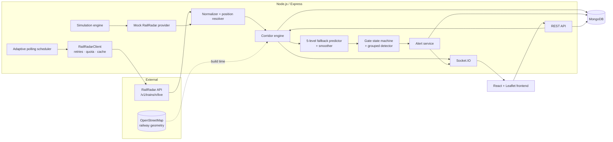
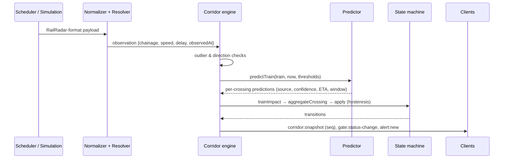

# SmartCross — Railway Crossing Monitoring & Prediction

SmartCross predicts the status of four level crossings ("phataks") on the **Patiala (PTA) – Dhablan (DBN)** railway corridor in Punjab, India. It combines live train data (RailRadar API), the timetable and historical observations, and tells road users:

- whether a crossing is **predicted** open, closing soon, closed or reopening
- which train is approaching, from which direction and how far away it is
- the estimated arrival time, closure duration and reopening time
- which neighbouring crossings will be affected (grouped closures)
- **what the prediction is based on** (live position, dead reckoning, timetable…) and how confident it is

> **Important.** SmartCross has no gate sensors. Every crossing state is a **software prediction** derived from train data. It never claims to know the physical barrier position. Only monitored passenger trains are covered; unscheduled and freight trains are not predicted.

---

## Contents
1. [Features](#features)
2. [Quick start](#quick-start)
3. [Architecture](#architecture)
4. [Folder structure](#folder-structure)
5. [Corridor & GIS verification](#corridor--gis-verification)
6. [Prediction algorithm](#prediction-algorithm)
7. [Gate state machine](#gate-state-machine)
8. [Adaptive polling & API quota](#adaptive-polling--api-quota)
9. [Simulation mode](#simulation-mode)
10. [Database design](#database-design)
11. [REST API](#rest-api)
12. [Socket.IO events](#socketio-events)
13. [Configuration](#configuration)
14. [Testing](#testing)
15. [Security](#security)
16. [Known limitations](#known-limitations)

---

## Features

| Area | What you get |
|---|---|
| **Prediction engine** | Along-track (chainage) distance on OpenStreetMap railway geometry; five-level fallback; ETA smoothing with outlier rejection; staleness detection; confidence per prediction |
| **Gate state machine** | `OPEN → CLOSING_SOON → CLOSED → OPENING_SOON → OPEN` plus `UNKNOWN`; handles multiple trains, opposite directions and back-to-back trains; anti-flap hysteresis; timetable-only data can never assert `CLOSED` |
| **Grouped closures** | Group A (19 & 20) and Group B (23 & 24): closure sequence, each crossing's own window and overlap flag. Barriers are never assumed to close simultaneously |
| **Live data** | RailRadar `/v1/trains/{n}/live`, parsed using the documented schema; bounded retries, timeouts, caching, in-flight de-duplication, quota from `X-RateLimit-*` headers |
| **Adaptive polling** | Timetable decides *when* to poll (20 min before entry → 10 min after exit); proximity decides *how often*; daily budget from the remaining monthly quota |
| **Simulation** | Multiple trains, direction, speed, start position, delay/hold, GPS loss, 7 scenarios. Same engine and state machine as live data; clearly labelled |
| **Frontend** | Dashboard, live Leaflet map, train monitoring, crossing details, alerts, analytics, admin, settings, simulation |
| **Real time** | Socket.IO snapshots with sequence numbers (duplicates and out-of-order events are dropped), reconnection with REST resync, stale-data banners |
| **Alerts** | In-app toasts, audio (Web Audio), browser notifications, personal warning threshold, mute/volume, alert history, server- and client-side duplicate suppression |
| **Analytics** | Train frequency, speed, waiting time, predicted vs observed arrival, error by horizon/source, closure patterns, source distribution, API usage — each chart labelled **RECORDED / PREDICTED / ESTIMATED** and filtered by live vs simulated data |
| **Ops** | Docker Compose with health checks, graceful shutdown, admin authentication, rate limiting, validation, TTL retention |

---

## Quick start

### Docker (recommended)

```bash
cp .env.example .env          # set ADMIN_PASSWORD, JWT_SECRET and optionally RAILRADAR_API_KEY
docker compose up --build
```

Open **http://localhost:8080**. Without `RAILRADAR_API_KEY` the system starts in **simulation mode**: go to *Simulation*, sign in with `ADMIN_PASSWORD` and start a scenario.

### Local development

Requirements: Node.js 20+, and optionally MongoDB 7 (otherwise an in-memory MongoDB is used in development).

```bash
npm run install:all
cp .env.example backend/.env           # adjust MONGODB_URI etc.
npm run dev:backend                     # http://localhost:5000
npm run dev:frontend                    # http://localhost:5173 (proxies /api and /socket.io)
```

In development, the admin password defaults to `smartcross-dev` if `ADMIN_PASSWORD` is not set.

Useful scripts (run from `backend/`):

| Command | Purpose |
|---|---|
| `npm test` | All 132 backend tests (unit + integration) |
| `npm run seed` | Idempotent seed of crossings, trains, timetables, mappings |
| `npm run verify-coords` | GIS verification report for the crossings |
| `npm run build-track` | Rebuild `src/data/corridorTrack.json` from the OSM export |
| `npm run check-railradar -- 14508` | One real API call with your key; prints the normalized result (uses 1 quota call) |

---

## Architecture



**Live and simulation are separate modes.** The engine holds trains for exactly one mode. Switching mode clears all train state and resets crossings to `UNKNOWN`, and every stored record carries its `mode`. Simulated trains go through a mock that produces responses in RailRadar's documented format, so they exercise the same normalizer, resolver, predictor and state machine as live data.



---

## Folder structure

```
smartcross/
├── docker-compose.yml, .env.example, package.json
├── backend/
│   ├── data/osm_track.json            # raw Overpass export (ODbL)
│   ├── scripts/                       # buildCorridorTrack, fetchOsmTrack, verifyCoordinates, checkRailRadar
│   ├── src/
│   │   ├── index.js                   # server start, graceful shutdown
│   │   ├── app.js                     # express app (helmet, CORS, rate limit, routes)
│   │   ├── config/                    # env.js (validated config), corridor.js (crossings/groups/geometry), constants, db
│   │   ├── data/                      # corridorTrack.json (OSM-derived), bundledTimetable.json
│   │   ├── models/                    # 15 Mongoose models
│   │   ├── controllers/, routes/, middleware/ (auth, validate, rateLimiter, errorHandler)
│   │   ├── seeds/seed.js
│   │   └── services/
│   │       ├── gis/                   # distance, DMS conversion, polyline projection, position resolver
│   │       ├── railradar/             # client, normalizer, live service, schedule service, mock provider
│   │       ├── prediction/            # ETA, 5-level fallback, smoother, historical learning/evaluation
│   │       ├── gate/                  # state machine, grouped closure detector
│   │       ├── engine/corridorEngine.js
│   │       ├── scheduler/, simulation/, alert/, analytics/, settings/, websocket/
│   │       └── runtime.js             # wires singletons
│   └── tests/                         # 13 suites, doc-shaped fixtures
└── frontend/
    ├── nginx.conf, Dockerfile, vite.config.js
    └── src/
        ├── context/                   # LiveData (snapshot + socket), Auth, Notifications
        ├── components/                # Layout, CorridorMap (Leaflet), CrossingCard, ui primitives
        ├── pages/                     # Dashboard, Map, Trains, TrainDetail, CrossingDetail, Alerts, Analytics, Admin, Settings, Simulation
        └── lib/                       # api, socket, constants, format
```

---

## Corridor & GIS verification

All corridor data lives in **`backend/src/config/corridor.js`**. The prediction engine never hard-codes crossing numbers. To add a crossing, add it to `CROSSINGS_CONFIG` (and optionally to a group); its order, chainage and direction sequence are derived automatically.

| Phatak | Name | Lat | Lon | Distance from OSM track | Chainage from PTA | Spacing |
|---|---|---|---|---|---|---|
| 19 | Station Approach | 30.339583 | 76.398417 | 2.6 m | 427 m | +427 m from PTA |
| 20 | Sirhind Road | 30.339667 | 76.392583 | 3.1 m | 1,001 m | +573 m |
| 23 | Model Town Extension | 30.340222 | 76.366583 | 1.0 m | 3,508 m | +2,507 m |
| 24 | Dhablan Approach | 30.339972 | 76.356778 | 1.3 m | 4,449 m | +942 m |
| DBN | Dhablan station | 30.337749 | 76.278590 | on track | 11,957 m | +7,508 m |

- **Verified:** the supplied DMS and decimal coordinates agree, and every crossing lies within 1–3 m of a node of the OpenStreetMap `railway=rail` line, consistent with OSM level-crossing nodes. The order PTA → 19 → 20 → 23 → 24 → DBN is confirmed by along-track chainage.
- **Track geometry:** OSM ways stitched into one polyline (`scripts/buildCorridorTrack.js`), with Patiala station on an OSM node. Corridor length is 11.96 km along the track.
- **Not fully verified:** the Dhablan station point is snapped to the OSM line at the coordinate used by the original project. Its exact platform position was not independently confirmed. It affects only the corridor end point, not the crossing predictions.
- Regional extensions (towards Rajpura and Nabha) are coarse and are used for map display and dead-reckoning bounds only.

---

## Prediction algorithm

**Linear referencing.** Every position is converted to *chainage*: metres along the track from Patiala station (positive towards Dhablan). Distance to a crossing is `(s_crossing − s_train) × directionSign`, an along-track distance rather than straight-line GPS distance.

**Where positions come from.** RailRadar's documented live response contains **no train latitude/longitude**. It provides `currentLocation.distanceFromOriginKm` and the route's station distances. The resolver maps the train's route kilometre posts for PTA and DBN onto the OSM corridor (scaled so the train reaches DBN at DBN's chainage). If an undocumented lat/lng is present, it is used only when it lies within 300 m of the track. Otherwise no position is fabricated.

**Five-level fallback** (`services/prediction/fallbackPredictor.js`):

| Level | Source | Used when | Confidence |
|---|---|---|---|
| 1 | `LIVE_POSITION` | position ≤ `STALE_DATA_THRESHOLD_SECONDS` (180 s) old | HIGH (fresh, moving, measured speed), else MEDIUM |
| 2 | `LATEST_OBSERVATION` | position ≤ `MAX_DEAD_RECKONING_SECONDS` (900 s) old; dead reckoning with effective speed and stop/dwell handling | MEDIUM (≤ 5 min), else LOW |
| 3 | `TIMETABLE_WITH_DELAY` | timetable + delay observed within `RECENT_DELAY_VALIDITY_MINUTES` | MEDIUM (delay ≤ 30 min old) / LOW |
| 4 | `HISTORICAL_AVERAGE` | ≥ `MIN_HISTORICAL_SAMPLES` observed live passages: mean offset from scheduled corridor entry | MEDIUM if tight, else LOW |
| 5 | `TIMETABLE_ESTIMATE` | timetable only (entry→exit time interpolated by chainage) | LOW |
| — | `UNKNOWN` | none of the above | NONE |

Confidence is also capped for long horizons (≤ MEDIUM beyond 30 min, LOW beyond 60 min). Every prediction carries train number, source, level, confidence, calculation timestamp, predicted arrival, ETA, closure start, reopen time and closure duration.

**ETA = distance / effective speed.** Effective speed blends measured speed (70%) with recent observed speeds (30%). It falls back to the historical average, then to `DEFAULT_CORRIDOR_SPEED_KMH`, and is clamped to `[MIN_EFFECTIVE_SPEED_KMH, MAX_TRAIN_SPEED_KMH]`, so division by zero is impossible. A stopped train at PTA/DBN adds its remaining scheduled dwell (departure + delay − now). A train stopped between stations adds a 60 s restart allowance. ETAs above 6 h become `UNKNOWN`.

**Closure window (estimate).** Closure starts `max(CLOSED_DISTANCE/v, CLOSED_ETA)` before arrival. Reopening is predicted when the tail (`TRAIN_LENGTH_METERS`) has passed `CLEARANCE_DISTANCE_METERS` plus `CLEARANCE_BUFFER_SECONDS`.

**Smoothing & outliers.** ETAs are exponentially smoothed against the expected decay (previous ETA − elapsed time). A single jump of more than 120 s is treated as an outlier and only partially applied; a jump that persists is accepted. Positions implying more than 1.5× the maximum train speed are rejected. Repeated movement against the expected direction flips the train's direction.

---

## Gate state machine

Software thresholds (configurable; **not** verified physical gate timings):

| State | Rule (per train, positional data) |
|---|---|
| `CLOSING_SOON` | ETA ≤ `CLOSING_SOON_THRESHOLD_MINUTES` (10) |
| `CLOSED` | moving train within `CLOSED_DISTANCE_METERS` (1200) **or** ETA ≤ `CLOSED_ETA_MINUTES` (2.5), or train occupying the crossing |
| `OPENING_SOON` | head has passed, tail not yet clear of the clearance distance/buffer |
| `OPEN` | cleared and no other train within the warning window |
| `UNKNOWN` | relevant train with insufficient data, or no data at all |

- **Timetable/historical predictions can at most produce `CLOSING_SOON`** (worded as "expected, no live position"). They never assert `CLOSED`.
- **Multiple trains:** `CLOSED` > `OPENING_SOON` > `CLOSING_SOON` > `UNKNOWN` > `OPEN`. A crossing is never shown `OPEN` because one train passed while another is approaching. If the next positional train's closure starts within `BACK_TO_BACK_GAP_SECONDS` of the first train's reopening, the crossing stays `CLOSED`.
- **Hysteresis:** escalations and passage-driven steps (`CLOSED→OPENING_SOON→OPEN`) apply immediately. Other downgrades (e.g. `CLOSING_SOON→OPEN`, `CLOSED→UNKNOWN`) must persist `DOWNGRADE_CONFIRM_SECONDS`.
- Every transition is stored as a `GateEvent` (with source, confidence, reason and the previous state's duration) and may produce one alert.

---

## Adaptive polling & API quota

RailRadar plans differ (the docs list Free 100/month and 10/min; Developer 30,000/month and 30/min). The quota is **configurable** (`RAILRADAR_MONTHLY_QUOTA`, default 1000) and is overridden by the `X-RateLimit-Remaining-Month` response header when present.

- Each train is tracked (timetable predictions) from `PREDICTION_LOOKAHEAD_MINUTES` before expected entry.
- Live polling starts `PRE_POLL_MINUTES` (20) before expected entry (schedule + known delay) and stops `POST_CLEAR_POLL_MINUTES` (10) after expected exit, or as soon as live data shows the train has left.
- The interval depends on the next crossing's ETA: ≤ 5 min → 45 s, ≤ 15 min → 90 s, otherwise 180 s. Intervals triple when 80% of the daily budget is used.
- Daily budget = (remaining quota − reserve) / days left in the billing period. When it is spent, only trains within 10 min of a crossing are polled.
- One request at a time, a 20 s response cache, in-flight de-duplication, a per-minute limiter, cooldown on HTTP 429, and a 30-minute stop on HTTP 401. Timetables are bundled (or fetched once per `SCHEDULE_REFRESH_DAYS` if `FETCH_SCHEDULES_FROM_API=true`).

---

## Simulation mode

*Simulation* page (admin login required, because it changes the system-wide mode):

- **Scenarios:** single train each way, grouped closure (Group B then A), opposing trains, back-to-back trains, delayed departure at Patiala, GPS dropout (dead reckoning).
- **Custom trains:** pick a monitored train or a custom number; set direction, speed (0–130 km/h), start position (distance before the entry station, at the station, distance before a crossing, or exact chainage), reported delay, a hold before departure, and optional signal loss after N seconds.
- **While running:** change target speed (0 stops the train), change the delay, toggle signal loss, remove trains, pause/resume, reset, or **Stop simulation**, which returns to live mode if a key is configured.

All simulated trains are named `SIM-<number>`, drawn in magenta, and tagged `SIMULATION` in every record. A permanent banner is shown in simulation mode.

---

## Database design

| Model | Purpose | Key indexes / retention |
|---|---|---|
| `Phatak` | crossing reference + last predicted state | `number` unique, `location` 2dsphere |
| `Train` | monitored train + last live observation | `trainNumber` unique, `currentLocation` 2dsphere (sparse) |
| `TrainSchedule` | timetable (bundled or RailRadar) with HH:MM validation | `trainNumber` unique |
| `TrainRoute` | route stops / km posts / geometry | `trainNumber` unique |
| `TrainLiveSnapshot` | every live observation (never simulated) | `{trainNumber, observedAt}` unique (dedupe), TTL `RETENTION_SNAPSHOT_DAYS` |
| `TrainPhatakMapping` | crossing sequence per train/direction | `{trainNumber, phatakNumber}` unique |
| `PhatakPrediction` | current prediction per mode/train/crossing | `{mode, trainNumber, phatakNumber}` unique, TTL 2 days |
| `Prediction` | prediction samples at 15/10/5/2-minute horizons | unique per mode/day/train/crossing/horizon, TTL |
| `PredictionEvaluation` | predicted vs observed arrival error | unique per sample, TTL |
| `HistoricalTrainObservation` | observed passages (from positional data only) | unique per mode/day/train/crossing, TTL |
| `GateEvent` | predicted state transitions | `{mode, phatakNumber, timestamp}`, TTL |
| `Alert` | alerts with dedupe key | `{mode, createdAt}`, TTL `RETENTION_ALERT_DAYS` |
| `NotificationSubscription` | per-browser notification preferences | `clientId` unique |
| `SystemSetting` | runtime thresholds, monitored trains | `key` unique |
| `AuditLog` | external API calls & admin actions | `{category, createdAt}`, TTL `RETENTION_AUDIT_DAYS` |

Seeding runs automatically at startup and is idempotent. TTL indexes are created when an index is first built; changing a retention value later requires dropping that index.

---

## REST API

Base path `/api`. Responses are `{ success, data }`; errors are `{ success: false, message }` (no stack traces).

| Method | Path | Auth | Description |
|---|---|---|---|
| GET | `/health` | – | liveness + DB status (503 if DB down) |
| GET | `/state` | – | full snapshot: mode, crossings with predictions, trains, grouped advisories, system |
| GET | `/corridor` | – | stations, crossings, groups, direction sequences, geometry |
| GET | `/system/status` | – | mode, feed health, quota summary, disclaimer |
| GET | `/phataks` · `/phataks/:number` · `/phataks/nearby?lat&lon&radius` | – | crossing views, history, advisories, nearest crossings |
| GET | `/trains` · `/trains/:number` | – | tracked trains, monitored timetable, per-train predictions, observations, polling plan |
| GET | `/predictions?phatak=` | – | active predictions (current mode) |
| GET | `/alerts?limit&phatak&type&mode&since` | – | alert history |
| POST | `/alerts/subscribe` | – | store browser notification preferences |
| GET | `/analytics/summary?days&mode` | – | analytics with data-kind labels |
| GET | `/settings` · `/simulation/status` | – | thresholds (read-only) · simulation state + scenarios + train catalogue |
| POST | `/auth/login` | – | `{password}` → JWT (rate-limited) |
| PUT / DELETE | `/settings` · `/settings/:key` | admin | change / reset a threshold or `MONITORED_TRAIN_NUMBERS` |
| PUT | `/admin/mode` | admin | `{mode: LIVE\|SIMULATION}` |
| GET | `/admin/metrics` · `/admin/api-logs` · `/admin/scheduler` | admin | metrics, logs, polling plan |
| POST | `/predictions/recalculate` · `/trains/:number/refresh` | admin | force evaluation · one live poll (uses quota) |
| GET | `/debug/railradar/:number` | admin | one raw live fetch with normalization diagnostics |
| POST | `/simulation/scenarios/:name` · `/simulation/trains` · `/simulation/start` | admin | start scenario · add train · start with `{scenario}` or `{trains:[…]}` |
| PATCH / DELETE | `/simulation/trains/:id` | admin | change speed/delay/signal · remove |
| POST | `/simulation/pause` · `/resume` · `/reset` · `/stop` | admin | control |

## Socket.IO events

| Event | Payload |
|---|---|
| `corridor:snapshot` | same shape as `GET /api/state`, with increasing `seq` (sent on connect and after each evaluation, at most twice a second) |
| `train:update` / `phatak:update` | per-train / per-crossing slices of each snapshot |
| `gate:status-change` | `{phatakNumber, previousStatus, newStatus, trainNumber, source, confidence, reason, mode, isPrediction: true}` |
| `alert:new` | stored alert document (`_id` for de-duplication) |
| `system:status` | emitted on mode changes |
| client → `snapshot:request` | ask for an immediate snapshot |

---

## Configuration

See **`.env.example`**, where every variable is documented. Key points:

- `RAILRADAR_API_KEY` is **only** read by the backend; it is never sent to the browser and never logged. Without it the app runs in simulation mode.
- `ADMIN_PASSWORD` / `JWT_SECRET` are required in production. Admin login is disabled if the password is missing or weak, and a warning is logged if example defaults are used.
- `MONGODB_URI` is required in production (no silent in-memory fallback).
- All prediction thresholds can be set via env or at runtime (Admin → Prediction thresholds, validated against bounds).

---

## Testing

```bash
cd backend && npm test
```

132 tests in 13 suites (Jest + Supertest + socket.io-client):

| Suite | Covers |
|---|---|
| `gis` | DMS conversion, OSM corridor checks (crossings < 5 m from track, order), chainage round trip, signed distances, position resolver (route km both directions, GPS on/off track, implausible km posts, no data) |
| `normalizer` | documented live/train-details payloads, invalid/mismatched data, future timestamps, IST corridor timing |
| `railRadarClient` | bearer auth, rate-limit headers, bounded retries, timeouts, 429 cooldown, 401, per-minute and monthly limits, cache/in-flight de-dupe, no key |
| `eta` | ETA = distance/speed, no division by zero, clamping, dwell, passage states, closure windows |
| `fallbackPredictor` | each of the 5 levels + UNKNOWN, required fields, stale delay, dwell at Patiala, direction ordering, horizon confidence |
| `smoother` | EMA, outlier rejection, persistent change, resets |
| `gateStateMachine` | thresholds, timetable never CLOSED, multiple/opposing/back-to-back trains, hysteresis, full cycle |
| `groupedClosure` | sequence 24→23, overlap flag, no false advisories, min confidence, multiple trains |
| `engine` | full state sequence along the corridor, opposing trains, outliers, direction flip, stale data degrading the source over time, mode separation, snapshot shape, alert de-duplication |
| `simulation` | mock RailRadar path, speed/stop, hold/delay, GPS loss → dead reckoning, all scenarios, validation |
| `scheduler` | polling window start/stop, intervals, budget exhaustion, client limits, ingest, never in simulation |
| `api.integration` | health, seeding, public endpoints, validation errors, admin protection, settings, simulation via API, alerts and analytics labels |
| `socket.integration` | snapshot on connect, train/gate/alert broadcasts, sequence numbers, reconnect |

Integration tests use an in-memory MongoDB (or `TEST_MONGODB_URI`).

---

## Security

- Helmet headers, CORS allow-list (`CLIENT_URL`), JSON body limit of 50 kB, API rate limit, login rate limit (10 per 15 min).
- Admin JWT required for every state-changing endpoint; timing-safe password comparison.
- Input validation on every parameter (train numbers, crossing numbers, coordinates, settings bounds, simulation specs). Mongoose schema validation and unique indexes prevent duplicates.
- Errors never expose stack traces or internal messages.
- Graceful shutdown on SIGINT/SIGTERM; MongoDB is not published by Docker Compose.
- **The original upload contained real RailRadar API keys in `.env.example` files. These have been removed, but rotate those keys.** `backend/.env` is not included in this delivery.

---

## Known limitations

1. **The live RailRadar integration was not exercised against the real service** while this version was built (the API host was not reachable from the build environment). It follows the documented response format (checked November 2026) and is tested with documented-shape fixtures and a local fake server. Run `npm run check-railradar -- <train>` once with your key to confirm.
2. **Train positions are derived from route kilometres**, because the documented live response has no lat/lng. Accuracy depends on RailRadar's `distanceFromOriginKm` and on the route km posts. RailRadar's position may itself be estimated: `trackingMode` is recorded but not interpreted.
3. **Timetables are bundled and unverified.** Spot check: 14508's Patiala arrival (07:29, 271 km) matches public timetables. The names for 26461/26462 appear incorrect, and some intermediate times differ. Set `FETCH_SCHEDULES_FROM_API=true` to replace them with RailRadar data (one call per train per refresh period).
4. **Gate timings are software thresholds**, not measured. Real barriers may close earlier (e.g. while a train dwells at Patiala) or stay closed longer. Calibrate the thresholds once observed gate behaviour is available.
5. **Freight and unscheduled trains are not covered.** "Predicted open" means no *monitored* train is expected.
6. **Free-tier quota (100 calls/month)** allows only a few polls per train per day. Most predictions will then be timetable-based (LOW confidence) except close to crossings.
7. **Historical averages (level 4)** need at least 5 live observed passages per train and crossing before they are used.
8. **Browser notifications** work while the page is open (backgrounded tab). There is no Web Push service worker.
9. Map tiles come from CARTO/OpenStreetMap and need internet access in the browser.

Map data © OpenStreetMap contributors (ODbL).
